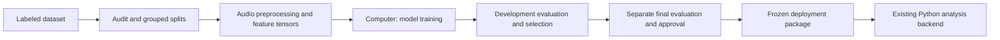

# Heart and Lung training, ESP32 acquisition, and WebSocket streaming

Updated: 2026-10-13. This guide describes the inspected repository and the Lung
results supplied from the Linux training machine. It documents implementation
and research methods; it does not establish clinical accuracy or physical-device
readiness. Model training runs on a computer, not on the ESP32.

## 1. Overall workflow

There are two connected workflows: developing a model from labeled datasets, and
analyzing a recording collected from the stethoscope. Live recordings do not
automatically become labeled training data or update model weights.

```mermaid
flowchart LR
    S[Stethoscope sensor and ADC or I2S] --> E[ESP32 acquisition task]
    E --> W[Wi-Fi: WebSocket publisher]
    W --> G[Device gateway]
    G --> B[Browser: waveform, listening, recording]
    B --> A[Completed PCM WAV]
    A --> N[HTTP: Next.js analysis endpoint]
    N --> P[Retained Python worker]
    P --> R[Heart DSP or approved organ model]
    R --> U[Structured result displayed in browser]
```





The current WebApp prototype uses Wi-Fi/WebSocket. The PRD also retains eventual
BLE/native-mobile/offline goals; these are separate implementation milestones.

## 2. Heart: what is trained and what is calculated

Heart analysis contains three branches:

| Branch | Method | Intended outputs |
| --- | --- | --- |
| Rhythm | DSP on the recording | BPM, beat intervals and rhythm screening category |
| Cardiac events | DSP on the recording | S1/S2 candidates, systole/diastole and experimental S3/S4 candidates |
| Murmur | Trained model, when an approved package is configured | Murmur score and Present/Absent screening result |

The murmur classifier is one part of Heart. Its labels do not train the rhythm or
cardiac-event branches. DSP timing candidates need their own labeled-recording
validation. A murmur score is not a disease diagnosis.

### 2.1 Dataset and labels

The Heart training pipeline uses CirCor DigiScope 1.0.3. Its supervised target is
participant murmur status: **Absent = 0**, **Present = 1**. Unknown labels are
excluded from this binary task; disease/outcome labels are not substituted.

Participants can contribute recordings at multiple chest locations. All linked
recordings/windows from a participant stay in the same partition or CV group.
The recorded baseline cohort contains 812 linked participants: 568 TRAIN, 122
validation and 122 reserved internal test. Historical SVM work already exposed
that internal test, so it is not a pristine final holdout for a new claim.

Participant/recording labels are weak supervision for a five-second window: a
positive participant does not imply that a murmur is audible in every site/window.
The Heart binary CNN does not learn murmur onset/offset from temporal annotations.

### 2.2 Preprocessing and CNN training

1. Validate audio and manifest identities; preserve participant-exclusive splits.
2. Convert to mono, resample to 8 kHz, remove DC and peak-normalize. Filtering is
   configurable; the documented baseline disables the optional bandpass.
3. Divide recordings into five-second windows with 50% overlap.
4. Compute numerical log-mel spectrogram tensors using FFT 512 and hop 128.
   The compact baseline uses 40 mel bins; the separate spectrogram experiment
   configuration uses 96 bins and per-frequency normalization. Experiment
   configurations must not be mixed when reproducing a result.
5. Train a CNN with a binary sigmoid output. The documented compact baseline uses
   Adam, binary cross-entropy, LR 0.001, batch size 32, maximum 50 epochs,
   dropout 0.30 and validation-loss early stopping with patience eight.
6. Apply participant-aware/class-balanced sample weighting so many windows from
   one participant do not dominate the baseline. Fit learned normalization only
   on permitted training data. Apply augmentation only when enabled by the
   selected protocol, and only during training.
7. Restore the best validation weights, aggregate scores using the declared
   recording/participant rule and select a development threshold. Screening
   threshold policies prioritize sensitivity, with specificity and false-positive
   consequences reported separately. The baseline's configured sensitivity target
   is 0.90 and minimum specificity target 0.50; these are not proof of achieving
   the project's full engineering goals.

Evaluate sensitivity, specificity, precision, F1, ROC-AUC, PR-AUC and the confusion
matrix on the declared unit. Window accuracy at threshold 0.5 is different from
participant performance at a selected threshold.

### 2.3 Advanced Heart research: H021

H021 is the repository's frozen strongest TRAIN-only Heart development result.
It uses five participant-exclusive outer folds, fold-local hard-negative acoustic
weighting, and a Stage-1 CNN producing 64-dimensional segment embeddings. Features
use 40-bin log-mel and fold-fitted per-frequency normalization. Embeddings are
averaged over segments per recording, then recordings per participant; a
fold-specific StandardScaler/L2 logistic head produces participant scores.

Its pooled OOF result over 568 participants is sensitivity 0.90, specificity
0.7445, precision 0.4583 and F1 0.6074. It still misses the full engineering gate.
Five evaluation pipelines are not a final all-TRAIN model or a declared deployment
ensemble. Its participant OOF threshold must not be applied to an arbitrary WAV,
a single CNN sigmoid or an invented fold ensemble. H022 is documented as prepared,
with no completed training result in the inspected freeze documentation.

### 2.4 Heart inference in the app

An approved Heart package must freeze weights, preprocessing, normalization and
recording-level evaluation/threshold evidence. The runtime adapter averages window
sigmoid scores per recording; this differs from H021's participant embedding/head
pipeline and needs its own evidence. Configure `AURISCORE_HEART_PACKAGE` only with
a verified final package. Without one, the app can run Heart DSP while reporting
Murmur unavailable. No approved package is established by the research metrics.

## 3. Lung: frame-level training and temporal localization

### 3.1 Dataset and supervision

Lung training uses HF_Lung_V1, pinned in the acquisition workflow to revision
`2a77d37230b1673d332645e6c6afeea29900bcf9`. Its acoustic labels map to six outputs:
**inhalation, exhalation, wheeze, rhonchi, stridor and crackle**. These are phases
and sounds, not disease classes. Source label `D` represents crackle-containing
intervals rather than individually timed crackle clicks.

The audit separates TRAIN, development validation, official test and quarantine.
Shifted recording dates provide conservative grouping proxies; verified patient
IDs are unavailable, so `patient_disjoint_verified` remains false. Official test
annotations stay sealed during development selection.

Annotations contain onset/offset times. Each feature frame receives six binary
targets plus six validity masks. Overlapping sounds are allowed. Negative
supervision is restricted to annotated respiratory regions; outside those regions
only explicitly positive events are supervised. Padded/invalid tails are masked.
Unannotated audio is not silently treated as a healthy negative. Annotation
completeness remains an assumption requiring review.

### 3.2 Preprocessing, model and optimization

| Setting | Lung baseline |
| --- | --- |
| Audio | Mono, 8 kHz after resampling, DC removal and peak normalization |
| Windows | Five seconds, approximately 50% overlap, starts aligned to the FFT hop |
| Features | 96-bin log-mel, FFT 512, hop 128, 20–1900 Hz, no centered FFT padding |
| Normalization | Per-frequency mean/std fitted using supervised TRAIN frames; normalized values clipped to ±5 |
| CNN | Conv2D widths 16/32/64, frequency-only pooling, 64-filter five-wide temporal Conv1D |
| Outputs | Six independent sigmoid scores for every feature frame |
| Loss | Masked binary cross-entropy with TRAIN-derived positive weights, clipped to 0.25–20 |
| Optimizer | Adam, initial LR 0.001 |
| Fitting | Batch size eight, maximum 50 epochs, patience eight, restore best validation weights |

Resampling a 4-kHz source to 8 kHz does not recover frequencies above its original
2-kHz Nyquist limit. Features are tensors, not exported spectrogram pictures.

The cached dataset currently contains 28,620 TRAIN and 17,688 validation windows.
TRAIN filenames are fully shuffled each epoch with a reproducible fold seed;
validation order stays fixed. Known batch cardinality preserves the last short
batch and avoids silently dropping examples. Overlapping windows mean frame
counts are not independent patient observations.

### 3.3 Development experiments and current status

| Experiment | Declared change | Status in this work |
| --- | --- | --- |
| EXP-L003 | Fixed-LR temporal baseline, dropout 0.2 | Completed on the Linux machine; best reported epoch two |
| EXP-L004 | Halve LR after two plateau epochs, floor 1e-6 | Completed; epoch-two checkpoint remained best before any reduction |
| EXP-L005 | Dropout 0.4, fixed LR | Completed; best validation loss 0.8241 at epoch two, mixed class metrics |
| EXP-L006 | Temporal dilation 16, dropout 0.2, fixed LR | Implemented in the local working tree; no training result yet |

EXP-L006 changes only the existing temporal convolution's dilation relative to
EXP-L003, preserving parameter count and frame output shape. The theoretical
context span increases from 11 frames/224 ms to 71 frames/1.184 s. This is a span,
not guaranteed uniform dependence on every frame. Symmetric padding uses future
samples and zero context near window edges; it is not causal streaming inference.

Training policies are versioned and recorded in experiment provenance. Existing
caches remain reusable for LR/dropout/dilation-only policies. Final fitting must
freeze the selected model policy; adaptive development LR schedules require frozen
per-epoch rates for final replay without validation/test callbacks.

### 3.4 Evaluation and localization

After restoring the best checkpoint, predict validation frames, select each class's
maximum-F1 development threshold and save predictions, metrics and provenance.
Report sensitivity/specificity, precision/F1, ROC-AUC and PR-AUC, including
always-positive comparisons and phase conflicts. High F1 alone can be misleading
for prevalent labels: EXP-L005 predicted inhalation on about 99.1% of supervised
frames and both phases on 87.3% of jointly supervised frames.

For temporal localization, average overlapping-window scores at absolute frame
positions, threshold each class and decode contiguous runs into onset/offset
intervals. Optional minimum-duration/gap-merging settings must be frozen.
Development boundary evaluation uses one-to-one event matches. A 16-ms feature hop
is time-grid spacing, not demonstrated 16-ms boundary accuracy. Respiratory rate,
phase durations and I:E require at least three complete unambiguous cycles;
otherwise values remain null with a reason.

The alignment review tool reparses sampled source annotations, verifies audited
audio/label hashes and regenerates cached features/targets/masks/timestamps. Six
local development recordings/36 windows matched exactly within the documented
feature tolerance. This verifies sampled source/cache consistency, not whether
the annotations match audible events; the generated listening review still needs
human inspection. No Lung candidate is approved for live activation.

## 4. ESP32: acquiring and publishing actual stethoscope audio

The ESP-IDF project provides ESP32-S3 AP setup and a reusable WebSocket transport.
The acquisition driver still needs the actual sensor/ADC/I2S hardware definition:
board, circuit, GPIO wiring, clocking, word format, channel, gain and DC handling.
Wi-Fi configuration alone cannot produce an audio recording.

A hardware-paced capture task supplies exactly 400 real signed PCM16 mono samples
at 8 kHz to `auriscore_stream_push(samples)` when `auriscore_stream_enabled()` is
true. Call from the capture task, not an interrupt handler. Each block represents
50 ms. The transport does not resample, pad, or generate substitute sound.

The component uses an eight-block bounded queue. Acquisition overflow or failed/
stale sends invalidate the stream instead of hiding lost samples. The inspected
workspace has no completed acquisition driver or physical firmware build/flash
verification. Successful software tests do not establish actual chestpiece capture.

## 5. Wi-Fi and WebSocket connection flow

The **gateway on the computer is the WebSocket server**. ESP32 publishes as a
client to `/device`; the browser controls/subscribes as a client to `/browser`.
Even when ESP32 hosts the Wi-Fi AP, it is not the WebSocket server.

1. The laptop joins the ESP32 AP, or both devices join the same configured router.
   The supplied firmware starts an AP; router/STA operation requires adapting
   Wi-Fi initialization before using the same transport component.
2. Start the gateway at a reachable laptop address, normally TCP port 8082.
3. Both clients authenticate with the configured pairing token. Browser origins
   must match the gateway allowlist. One publisher/controller pair is supported.
4. ESP32 sends `device_hello` with protocol 2, stream ID, source declaration,
   firmware identity and fixed audio format: 8 kHz, mono, `pcm16le`.
5. The browser sends `start_stream` with a unique command ID. ESP32 must acknowledge
   within three seconds; audio is accepted only after the successful acknowledgement.
6. ESP32 publishes binary PCM blocks. The gateway validates and forwards them,
   while the browser tracks continuity, updates waveform and optionally plays sound.
7. Stop recording controls local capture; `stop_stream` separately controls device
   streaming. Analysis mode selects Heart/Lung processing of the recording; it
   does not command the sensor to change organ or invent physical capture settings.

In AP mode configure the ESP32 URI as `ws://LAPTOP_IP:8082/device`, using the
laptop's IP on that network. `localhost` on ESP32 refers to ESP32, not the laptop.
The local laptop browser can use `ws://localhost:8082/browser`.

### 5.1 Packet contents and continuity

Each protocol-v2 frame is **832 bytes**: a 32-byte header followed by 800 PCM bytes.

| Header information | Meaning |
| --- | --- |
| `AURI`, protocol 2, header size 32 | Identifies the wire format |
| Flags | Acquisition-overflow indication; unknown flags rejected |
| Stream ID | New identity for each connection/reboot |
| Sequence | Increments once per audio block, wrapping as uint32 |
| First-sample index | Acquisition-clock position, increasing by 400 per block |
| Format fields | Rate 8000, sample count 400, channels one, PCM16LE encoding |

All numeric multibyte fields are little-endian. At 20 blocks/second, PCM alone is
16,000 bytes/second (128 kbit/s), plus headers and network overhead. Timing derives
from received sample counts, not packet-arrival timestamps.

Duplicate metadata is ignored; gaps, out-of-order data, changed streams, overflow
or malformed formats invalidate continuity. A two-second audio stall becomes an
error. Readiness requires real valid frames, not merely an open socket. Hardware
BPM/battery/quality remain unknown unless actually measured; an explicitly labeled
engineering source never silently substitutes for failed hardware.

## 6. Browser recording and existing backend analysis

The browser's waveform/listening and recording paths share validated received PCM.
AudioWorklet listening uses a jitter buffer and output resampling for the browser's
audio device. Listening volume, mute and concealment do not alter the original
recorded PCM. Playback requires an appropriate secure browser context.

The current main `RecordingSession` selects **10 seconds for Heart** and **30
seconds for Lung**. At 8 kHz those are 80,000 and 240,000 samples. Capture duration
is sample-based; early manual stop retains actual duration. Gaps, disconnects and
watchdog expiry fail capture rather than fabricating a complete recording.
Some earlier generic device documents describe only the ten-second capture;
the current organ-specific behavior is defined in `recording-session.ts`.

When capture ends, the browser encodes original mono PCM as WAV and submits
multipart `audio` and `mode=heart|lung` to `POST /api/analysis`. Organ-specific
routes also exist. This HTTP request is separate from WebSocket audio transport.

Next.js dispatches to the existing retained `scripts/analyze_recording.py --serve`
Python worker. Models remain loaded over multiple requests during worker lifetime.
The service validates input/quality, dispatches the selected organ backend and
returns structured results. The shared envelope is `organ-analysis-v1`; Heart and
Lung use `heart-analysis-v1` and `lung-analysis-v1` outputs. This path analyzes
completed recordings; it does not continuously run the trained models on each
incoming WebSocket block or return live AI results through that socket.

Configure `AURISCORE_PYTHON` and, for approved model inference,
`AURISCORE_HEART_PACKAGE` / `AURISCORE_LUNG_PACKAGE`. Packages require frozen
weights/preprocessing/thresholds, hashes and appropriate final evaluation/approval.
Research `.keras` files alone are insufficient. Heart can return DSP with Murmur
unavailable; without a Lung package, Lung returns structured unavailable output.
Current experiments must not be promoted merely because they trained successfully.

## 7. Running the gateway and checking the system

From `WebApp/mini-services/device-gateway` on Linux:

```bash
npm ci
export AURISCORE_DEVICE_TOKEN='<your pairing secret, at least 16 characters>'
export AURISCORE_GATEWAY_HOST=0.0.0.0
export AURISCORE_ALLOWED_ORIGINS=http://localhost:3000
npm start
```

Use actual local secrets outside Git. Start the existing WebApp separately,
configure its local Python backend, then choose the ESP32 Wi-Fi source and enter
the `/browser` endpoint and pairing token. Allow the gateway port only on the
intended development network. Plain WS is an isolated-LAN development choice;
protected deployment needs HTTPS/WSS. Pairing alone does not encrypt audio.

Training uses the separate `AI-Pipeline` commands and experiment directories.
See the detailed training guide for Linux commands, authorization and logs;
this document does not launch training, activate a package or flash hardware.

## 8. Source files and further reading

- [Product requirements](PRD.md), [architecture](ARCHITECTURE.md) and
  [AI research rules](AI_PIPELINE.md).
- [Heart baseline training](AI-Pipeline/docs/heart_cnn_real_training.md),
  [CNN implementation](AI-Pipeline/src/auriscore/cnn.py),
  [H021 freeze](AI-Pipeline/analysis/HEART-DEVELOPMENT-FREEZE-H021/README.md) and
  [H021 inference semantics](AI-Pipeline/analysis/HEART-DEVELOPMENT-FREEZE-H021/inference_notes.md).
- [Heart package/inference contract](AI-Pipeline/docs/heart_inference.md).
- [Lung training commands](AI-Pipeline/docs/lung_training.md),
  [Lung trainer](AI-Pipeline/src/auriscore/lung_training.py),
  [Lung model](AI-Pipeline/src/auriscore/lung_models.py),
  [alignment review](AI-Pipeline/scripts/review_lung_alignment.py) and
  [temporal localization](AI-Pipeline/docs/lung_localization.md).
- [Exact WebSocket wire contract](DEVICE_STREAMING_PROTOCOL.md),
  [gateway/browser setup](WebApp/docs/device-streaming.md),
  [firmware integration](Firmware/esp32-streaming/README.md) and
  [hardware team handoff](HARDWARE_TEAM_HANDOFF.md).
- [Organ recording duration and lifecycle](WebApp/src/lib/auriscore/recording-session.ts)
  and [existing backend integration](WebApp/docs/organ-analysis.md).

EXP-L006 code and the alignment review are included in the integration. No
EXP-L006 training result or newly approved deployment package is established.
